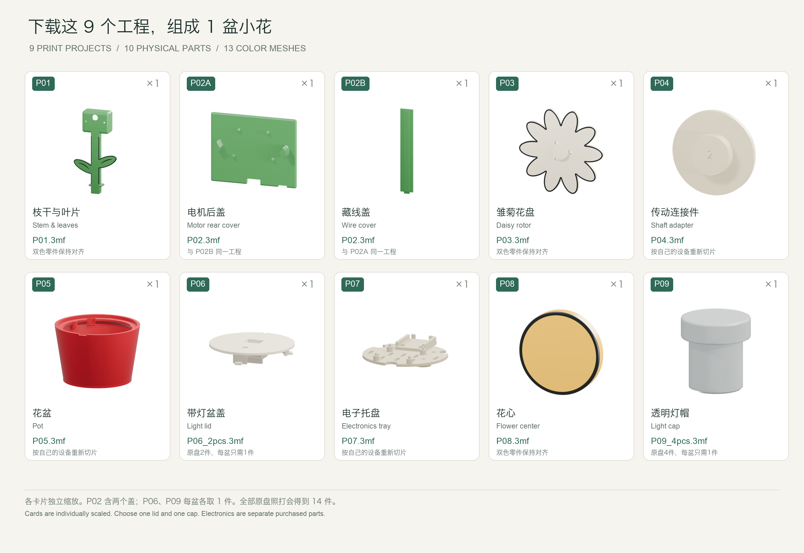

  

<h1 align="center">Rotating Flower · 旋转花</h1>

<strong>AI 在忙，一眼可见。</strong>

<a href="README.md">English</a> · 简体中文

  <a href="#watch">看视频</a> ·
  <a href="#start">开始使用</a> ·
  <a href="#compatibility">应用支持</a> ·
  <a href="#models">模型与制作</a> ·
  <a href="#faq">常见问题</a>

一朵通过 USB 连接 Mac 的桌面小花。AI 工作时，花盘跟着转；需要你回答时，小灯会亮起来。你可以先忙别的，抬头看看它。

## 72 秒看看它怎么工作

https://github.com/user-attachments/assets/a38f9855-469f-46ad-a9b5-1f78d493e84b

**[播放中文版](https://github.com/user-attachments/assets/a38f9855-469f-46ad-a9b5-1f78d493e84b)** · [Watch in English](https://github.com/user-attachments/assets/debc0f6c-ad6e-49d3-a212-e0ad689b4f36) · [更多视频和图片](hardware/daisy-light/VISUAL_GUIDE.md)

用实际打印模型做了一段 72 秒动画，看看小花怎么转、怎么提醒，以及 10 个零件怎样拼在一起。配了原创音乐，没有旁白。

片中展示了 **Codex、WorkBuddy 和 DeepSeek Harness（DSH）**，各应用对应的版本见[下方说明](#compatibility)。

| AI 的状态 | 小花的表现 |
| --- | --- |
| 正在工作 | 花盘转动 |
| 任务暂停，等你回答或授权 | 呼吸灯亮起；如果没有其他任务在运行，花盘也会停下 |
| 有的任务工作，有的任务等待 | 一边转动，一边亮灯 |
| 全部工作结束，也没有等你处理的事 | 停转，灯灭 |

不同模式有各自的预设转速，同时跑多个任务时，取其中最高的一档。有些问题不会暂停工作，这时小花会继续转，灯也会亮着等你回答。

## 从这里开始

| 你现在的情况 | 下一步 |
| --- | --- |
| 已经有装好的小花 | [安装 Mac 软件](#install)，连接 Codex 或 WorkBuddy |
| 想从零做一朵 | 从[图解制作教程](docs/diy-guide/README.md)开始，准备材料、打印和装配 |

## 支持哪些应用

| 应用 | 当前版本入口 | 状态 |
| --- | --- | --- |
| Codex | [v0.6.0](https://github.com/dalaofei1154/rotating-flower/releases/tag/v0.6.0) | 已提供下载 |
| WorkBuddy | [v0.6.0](https://github.com/dalaofei1154/rotating-flower/releases/tag/v0.6.0) | 已提供下载 |
| DeepSeek Harness（DSH） | [v0.7.0 适配进展](docs/dsh-macos.md) | 本地试用中，安装包稍后提供 |

小花软件支持 **Apple 芯片 Mac、macOS 12+**；DSH 自身需要 **macOS 13+**。目前可下载的 v0.6.0 支持 Codex 和 WorkBuddy。DSH 适配使用的是 0.2.1-rc.5，进展和档位对应关系见 [DSH 说明](docs/dsh-macos.md)。

## 已有小花：安装 Mac 软件

**[下载 v0.6.0 安装包](https://github.com/dalaofei1154/rotating-flower/releases/download/v0.6.0/RotatingFlower-Mac-v0.6.0.zip)** · [完整安装与升级说明](docs/open-release/INSTALL.md)

先装好小花，烧录[旋转＋提醒灯组合固件](firmware/README.md)，并安装好 Codex 或 WorkBuddy。小花安装包自带 Python，不需要单独填写 API Key。

1. 用 USB **数据线**连接小花，解压安装包。
2. 双击 `安装小花.command`，跟着提示安装。
3. 打开并登录 Codex 或 WorkBuddy，开始一个任务。

安装包还没有签名，macOS 可能会显示安全提示，具体操作见[安装说明](docs/open-release/INSTALL.md)。升级、卸载和文件校验也放在这份说明里。

## 从模型，到你桌上的小花

一盆需要 **10 个打印件**。资料包含 **9 个 3MF 打印工程、13 份分色 STL、10 份可编辑 Blender 网格场景**。有些打印盘里放了备用零件，按清单取一套，再按自己的打印机重新切片。

**[按图选择模型](hardware/daisy-light/VISUAL_GUIDE.md)** · [打印参数](hardware/daisy-light/README.md) · [材料清单](docs/diy-guide/BOM.md) · [完整资料入口](docs/open-release/README.md)

1. **准备材料**：按材料清单购买电机、控制板、灯板、线材和紧固件。
2. **打印与试装**：选择模型、确认颜色与数量，试试各个接口的松紧。
3. **接线与烧录**：依照图解教程断电接线，烧录组合固件，再安装 Mac 软件。
4. **检查与使用**：按[验收表](docs/diy-guide/CHECKLIST.md)检查旋转、停转、提醒灯和合盖后运行。

我现在装的是 L2 带灯盆盖和 P4 透明灯帽，转动和亮灯都正常。花心、透明灯帽、枝干与盆盖这几处没用胶，连接还有点松，后面会继续改；目前搬动时托住花盆就好。详细装配过程见[制作教程](docs/diy-guide/README.md)。

## 它怎样工作

Mac 上的小花软件读取本机任务状态，通过 USB 把指令发给 ESP32，再由控制板驱动电机和提醒灯。

| 想了解什么 | 从这里看 |
| --- | --- |
| 下载包对应的源码 | [v0.6.0 源码快照](software/release-v0.6.0/README.md) |
| DSH 适配进展 | [适配说明](docs/dsh-macos.md) |
| 硬件与固件 | [模型文件](hardware/README.md) · [组合固件](firmware/README.md) |
| 制作资料更新 | [更新记录](docs/open-release/RELEASE_NOTES.md) |

## 常见问题

**视频里的音乐是小花发出来的吗？** 
音乐是给介绍片配的，小花靠转动和灯光提醒你。

**小花需要联网或填写 API Key 吗？会上传我的对话吗？** 
小花通过 USB 连接 Mac，读取应用在本机的任务状态，不需要另填 API Key，也不向本项目服务器上传任务记录。AI 应用照常用你自己的账号登录。[本地数据说明](docs/open-release/INSTALL.md#data)

**可以修改模型，做成自己的样子吗？** 
可以，欢迎拿去做非商业改编。保留署名，分享修改后的模型时使用相同许可就好。[查看许可范围](LICENSES.md)

## 分享你做的小花

如果你也做了一朵，欢迎在 [Issues](https://github.com/dalaofei1154/rotating-flower/issues) 发张照片，顺便说说用的打印机和耗材。改好了哪个接口、遇到了什么问题，也可以在那里交流。[参与贡献](CONTRIBUTING.md) · [创作与参考说明](docs/open-release/ATTRIBUTION.md)

- **软件与固件：MIT。**
- **原创教程文字：CC BY 4.0。**
- **选定模型、DIY 图片、渲染、视频与原创配乐：CC BY-NC-SA 4.0。**

各类文件的许可和第三方素材说明见 [LICENSES](LICENSES.md)。模型或图片、视频等素材如需商用，请联系我。

这是 Flynn 的个人项目，建模和代码也借助了 AI 工具。项目原名 `codex-rotating-flower`。
