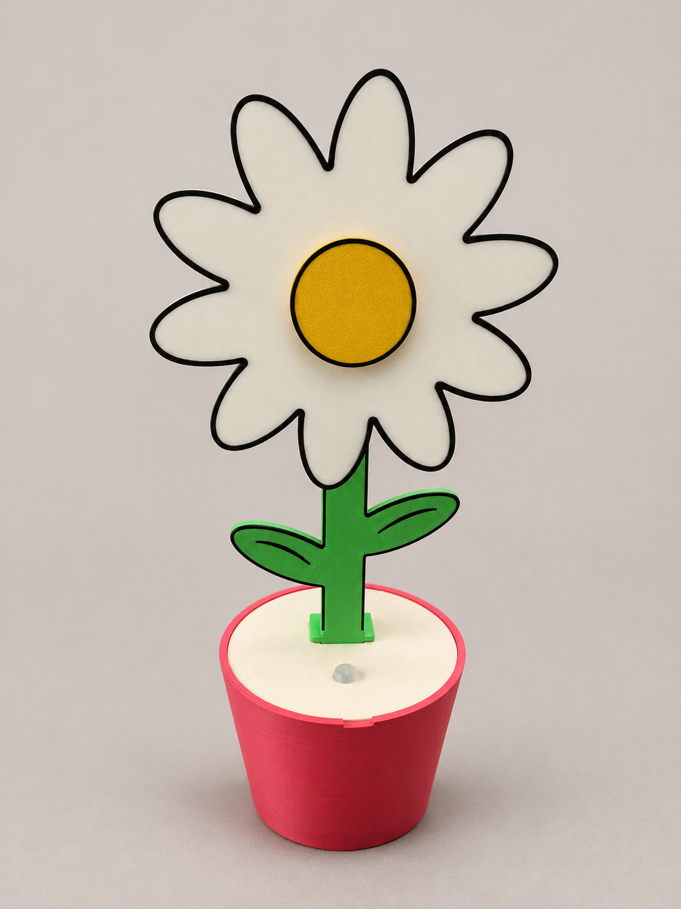
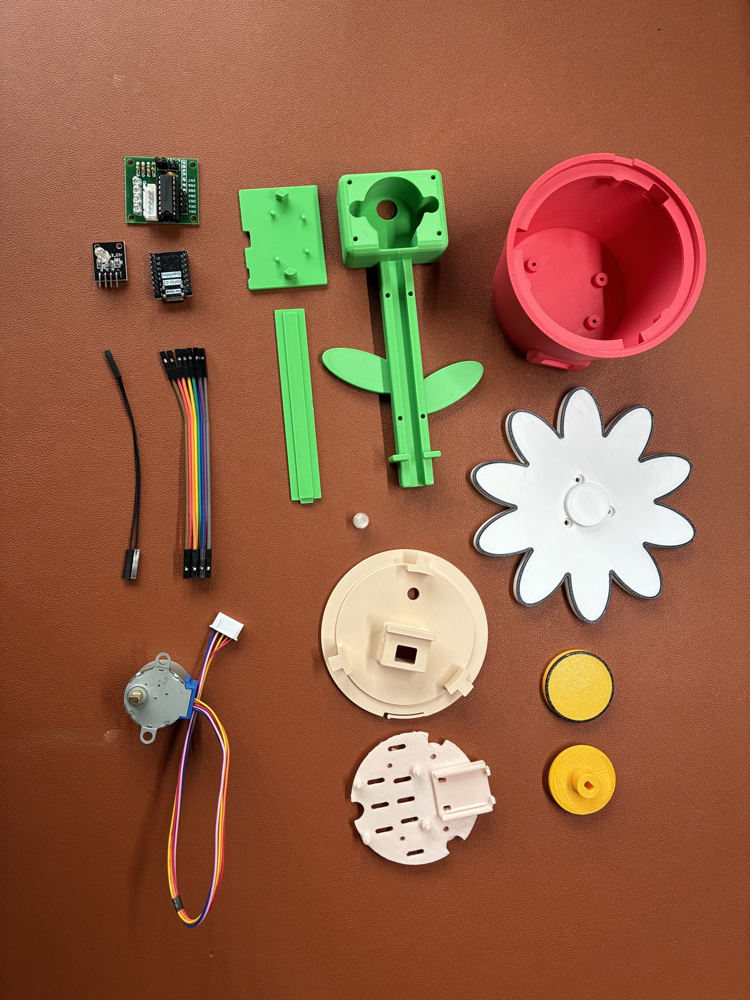
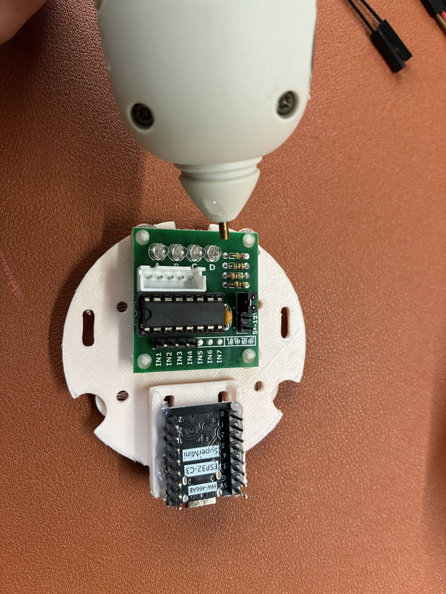
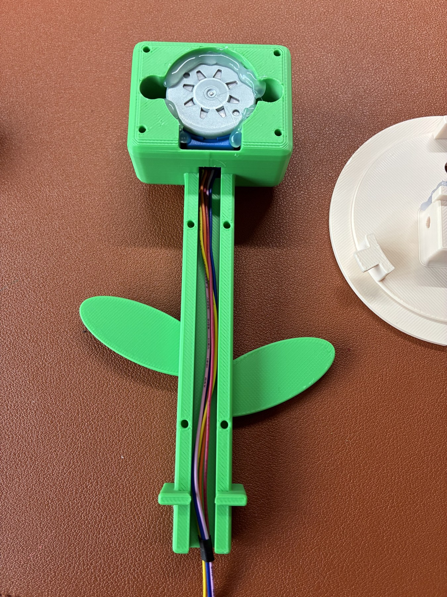
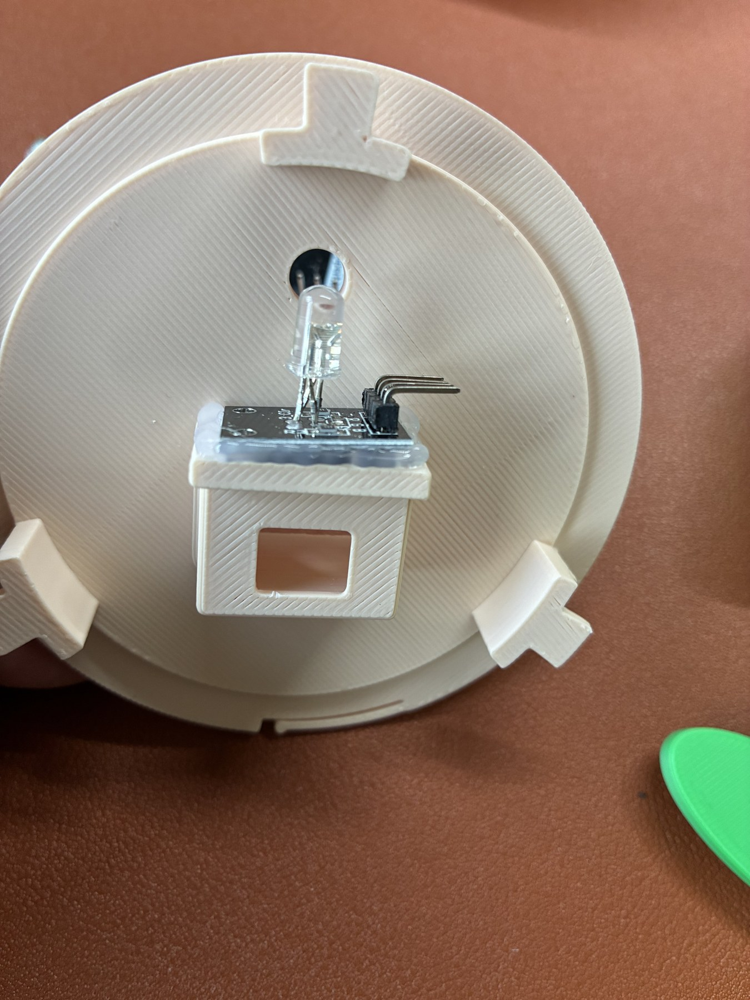
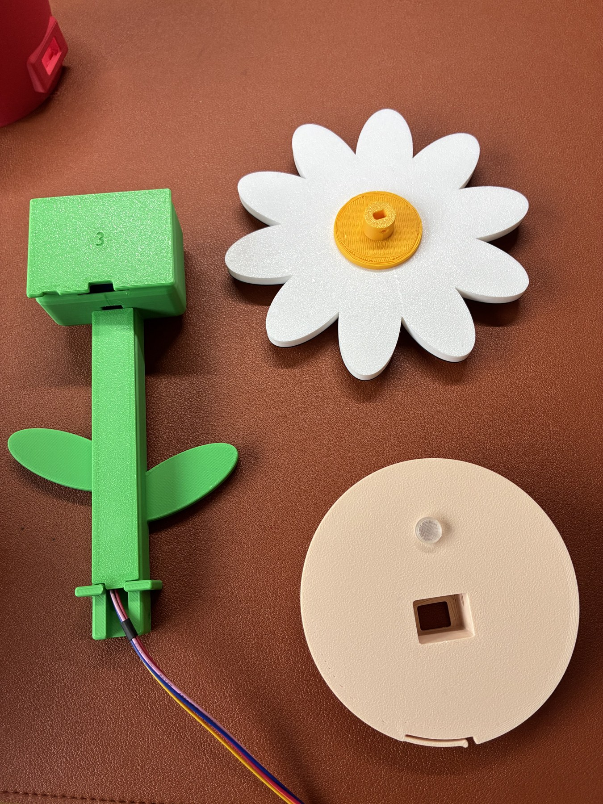
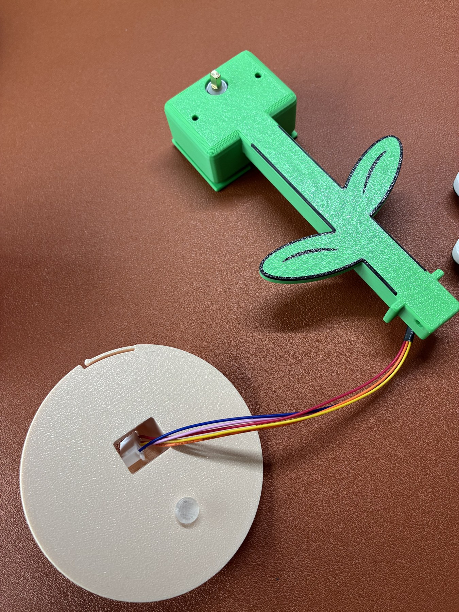
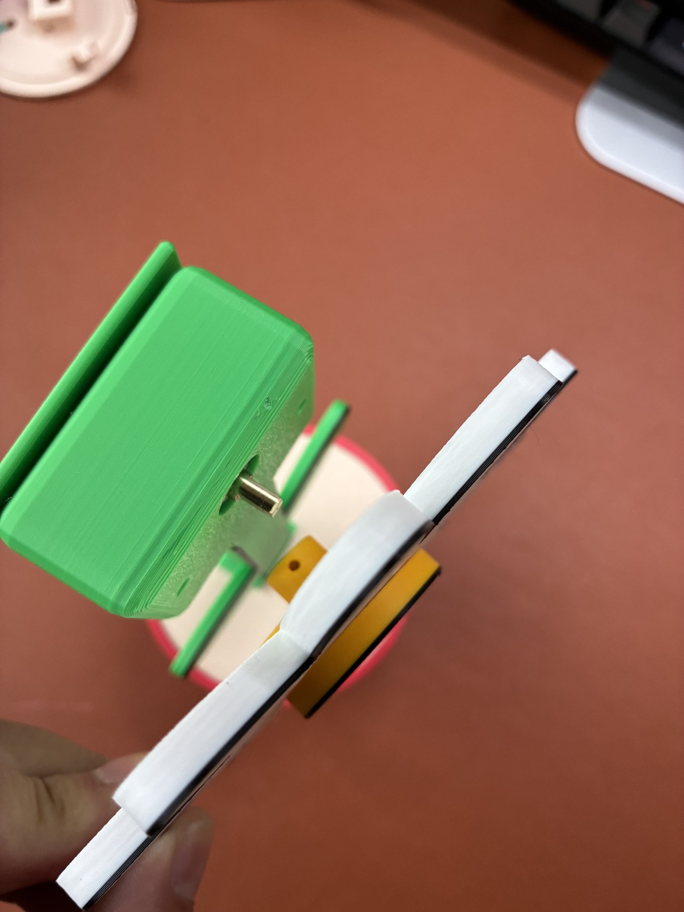

# Build the rotating daisy with an attention light

[简体中文](README.md) · **English**

Build a USB-powered desk flower that rotates with local AI work and lights up when a task needs your response. This guide covers the daisy, ESP32-C3 SuperMini, ULN2003 driver, 5 V 1:16 28BYJ-48 motor and common-cathode KY-016 module.

The listed materials total **CNY 53.92 (about 54 yuan)**; see the [cost breakdown](BOM.md#costs). The USB data cable, tools, consumables and shipping are extra.

Use the combined `FLOWER_COMBINED_V1` firmware and the v0.6.0 Mac installer. My current build uses the L2 lid and P4 clear cap, and both motion and light work. The center, cap and stem-to-lid joint are fitted without glue and are still a little loose. I plan to improve those fits; carry the flower by the pot.

The finished-product photo has a replaced background. The assembly photos below show the actual build.

## Prepare the parts

Start with the bilingual [bill of materials](BOM.md), [printing settings](PRINTING.md), [wiring reference](WIRING.md) and [build checklist](CHECKLIST.md). Download the matching [models](../../hardware/README.md).

The finished assembly uses ten printed parts: stem with leaves, motor cover, wire cover, daisy rotor, center, shaft adapter, pot, L2 light lid, P4 transparent cap and electronics tray. Colored STL components are not additional finished parts. Keep the black outlines aligned with their main bodies when loading the model project.

Use PLA, a 0.4 mm nozzle, 0.20 mm layers and 100% scale as a starting point. Reslice for your printer and actual filament. The per-part wall and infill values, L2 orientation, P4 settings and fit checks are in [PRINTING.md](PRINTING.md). Do not send another printer's G-code to your machine.

Dry-fit everything before using glue. Check the pot/tray locating sleeves, lid lock, stem opening, motor cavity, covers, adapter, center and cap. Ensure that the USB port lines up with the opening in the pot. Use the L2 short mounting block supplied in the model set; earlier assembly photos can show a larger light bracket.

## Assemble the mechanism

Disconnect USB before every wiring change, glue application or mechanical adjustment.

1. **Mount the electronics on the tray.** Place the ULN2003 on the broad surface and the ESP32 in the side frame, with USB facing the pot opening. Apply small amounts of hot glue at the board edges. Keep headers and sockets clear. The tray remains removable from the pot.

   

2. **Fit the motor and route its cable.** Seat the motor in the upper cavity with its shaft through the front and the cable pointing downward. Check clearance before adding hot glue between the motor housing and the printed seat. Keep glue off the shaft. Lay the cable in the rear channel, then fit the motor cover and long wire cover without pinching it.

   

3. **Fit the attention light.** Align the KY-016 LED with the lid's small round hole and secure the board to the underside mounting block with hot glue. Leave access to all four terminals. Test-fit the transparent cap from the front without glue. It must not press on the LED or obstruct the stem opening. Check whether the cap stays in place. Use the KY-016 version with four right-angle male pins along the board edge, and leave room for the female connectors and wires.

   

4. **Prepare the rotor.** Press the adapter into the back of the daisy with its shaft-hole boss facing outward. It should stay centered and secure; a little hot glue can reinforce the fit, but no glue should enter the shaft hole. Fit the yellow center on the front without glue and check its retention. Set the rotor aside until the bare-shaft electrical tests pass.

   

5. **Pass the motor plug through the lid first.** Keep it disconnected from the driver. Feed the white five-pin plug through the square lid opening from the top, then seat the stem. Check that the wire is not trapped at the edge. Check that the stem is seated and note any wobble.

   

6. **Wire and test before closing.** Connect each pin using the table below. Place the parts securely, leave the rotor off, then flash and test as described in the next section. After testing, stop the motor, turn off the light and disconnect USB before continuing assembly.

7. **Shield the driver's indicator LEDs if needed.** An opaque piece with an electrically insulating surface and insulating tape can prevent driver LEDs from being confused with the attention light. Do not press metal foil or conductive coatings against exposed contacts. Keep connectors accessible.

8. **Fit the tray and close the pot.** Align its locating sleeves and USB opening, then lower it into the pot. Route slack clear of the lid tabs and board pins. Seat and gently lock the lid; do not force it or trap wires. Confirm that a USB plug inserts without being bent by the enclosure.

9. **Install the rotor last.** Support the motor housing, align the adapter's flat-sided hole with the motor shaft and press axially. Do not twist the petals to enlarge the hole. Leave clearance behind the rotor. Start at LOW, stopping immediately if it rubs, wobbles excessively or loosens.

   

## Wire the electronics

| ESP32-C3 | Connect to |
| --- | --- |
| 5V | ULN2003 + |
| G / GND | Both ULN2003 − and KY-016 − via a ground splitter |
| GPIO4 / 5 / 6 / 7 | ULN2003 IN1 / IN2 / IN3 / IN4 respectively |
| GPIO0 / 1 / 3 | KY-016 R / G / B respectively |

Plug the motor's five-pin connector into the driver after routing it through the lid. GPIO numbers are board labels, not header positions. Do not power the motor from 3V3. Use a common-cathode KY-016 with onboard resistors; a bare RGB LED is not a direct replacement. See the full [wiring diagram and photo](WIRING.md).

## Flash and test the combined firmware

Open [flower_integrated.ino](../../firmware/flower_integrated/flower_integrated.ino) in Arduino IDE. The verified build used Arduino-ESP32 **3.3.11**, **ESP32C3 Dev Module**, **USB CDC On Boot = Enabled**, **Flash Mode = DIO**, and **Upload Speed = 115200**. Select the actual USB port, compile and upload.

For a first build, flash and test before installing the Mac bridge. If a background flower service is already installed, stop it before opening Serial Monitor; simply closing Codex or WorkBuddy may not release the port. The installer's `卸载小花.command` removes the whole flower background service while retaining logs and backups; reinstall after manual testing if you use this route.

Open Serial Monitor at **115200 baud**, sending a newline after each command:

| Send | Expected response or observation |
| --- | --- |
| `DEVICE INFO` | Contains `FLOWER_COMBINED_V1 PWM=OK` |
| `PING` | `PONG` |
| `RUN LOW` | `RUNNING LOW` and actual shaft rotation |
| `STOP` | `STOPPED` and actual stop |
| `ATTENTION ON` | Visible breathing light |
| `LED STATUS` | `LED_STATE=ON PWM=OK` while the light is active |
| `ATTENTION OFF` | Light off |

A single `ATTENTION ON` expires after approximately six seconds without renewal. A single `RUN` command expires after approximately 30 seconds without renewal. Check the corresponding timeout responses and physical stop/off behavior. Finish with `STOP`, `ATTENTION OFF`, `STATUS` and `LED STATUS`; expect `IDLE` and `LED_STATE=OFF`.

After the bare-shaft tests pass, assemble the rotor and repeat LOW. Then briefly test LOW, MEDIUM, HIGH, XHIGH and ULTRA in order, sending STOP between presets.

## Install the Mac bridge

Use an **Apple silicon Mac with macOS 12 or later** and local Codex or WorkBuddy tasks. Assemble, flash and test the flower before installing the bridge.

1. Close Serial Monitor and any old foreground bridge. Only one process should control the USB serial port.
2. Download the [v0.6.0 Mac installer](https://github.com/dalaofei1154/rotating-flower/releases/tag/v0.6.0), extract it and double-click **安装小花.command**. It includes Python and needs no API key. It does not flash firmware.
3. The installer detects installed Codex and WorkBuddy applications and enables either or both. Open and sign in to the application yourself, then start a task. Run the installer again if you later add the other app.
4. If macOS shows a security prompt, follow the [installation guide](../open-release/INSTALL.md#en) to allow the installer script to open.
5. Check task start, completion, cancellation and a structured question card. The flower should rotate during work, stop when all work ends, light for a recognized pending question and clear that reminder after it is answered. If another task is working, rotation and the light can coexist.

WorkBuddy Fast / Balanced / Deep use LOW / HIGH / ULTRA. Codex uses five speed presets based on the selected reasoning effort. The light indicates questions waiting for your response.

The bridge starts at Mac login. To remove it, double-click **卸载小花.command** from an extracted installer. This removes all flower background integration, retaining logs and backups.

## Finish and troubleshoot

Work through the bilingual [build checklist](CHECKLIST.md) to check the finished flower.

| Symptom | Check |
| --- | --- |
| No serial port | Data cable, USB connection, actual port and board configuration |
| Serial replies but no motor movement | Disconnect power; check 5V, common ground, IN1–4 order and five-pin plug |
| Motor works but light does not | Combined firmware identity, common-cathode module, GPIO0/1/3, ground and timeout |
| Rotor rubs or wobbles | Stop and disconnect; inspect adapter alignment, shaft fit and rear clearance |
| Works before closing but fails afterward | Disconnect; inspect trapped wires, pulled connectors and exposed contacts |
| Manual tests pass but task integration fails | Close competing serial programs; verify application readiness and installer diagnostics |

## Attribution and reuse

Models and DIY photos use **CC BY-NC-SA 4.0**: credit the project, use them noncommercially and share adaptations under the same license. Tutorial text uses CC BY 4.0; software and firmware use MIT. See [LICENSES.md](../../LICENSES.md), [model terms](../../hardware/LICENSE.md) and [image terms](images/LICENSE.md).
