# 旋转花带灯版制作教程

**简体中文** · [English](README.en.md)

从一套 PLA 打印件和四个电子模块，装出一盆会旋转、能亮灯提醒的小花。本教程覆盖零件准备、机械装配、接线和首次测试，适用于 ESP32-C3 SuperMini、ULN2003、5 V 28BYJ-48（1:16）及 KY-016 RGB 灯板的组合。

本教程使用雏菊带灯版模型、`FLOWER_COMBINED_V1` 组合固件和 v0.7.0 Mac 安装器。

本次所列材料参考成本为 **53.92 元人民币（约 54 元）**，明细见[材料价格表](BOM.md#costs)。USB 数据线、工具、辅料和运费另计。

开始前准备好 [采购清单](BOM.md)、[打印与干装说明](PRINTING.md)、[接线速查](WIRING.md) 和 [装配检查表](CHECKLIST.md)。推荐顺序是 **核对模型 → 打印 → 不用胶试装 → 断电接线 → 烧录与空轴测试 → 完整装配 → 安装 Mac 软件 → 任务联动测试**。

模型正在重新设计，暂不提供下载，详见[模型状态](../../hardware/README.md)。以下教程保留旧版装配记录，使用 L2 短安装块盆盖和 P4 灯帽。照片记录了我的装配过程，部分照片里的灯板支架比当前模型大一些。我的实物转动和亮灯都正常；花心、灯帽、枝干与盆盖的连接没有用胶，目前还有些松，后续会继续改进。搬动时托住花盆。

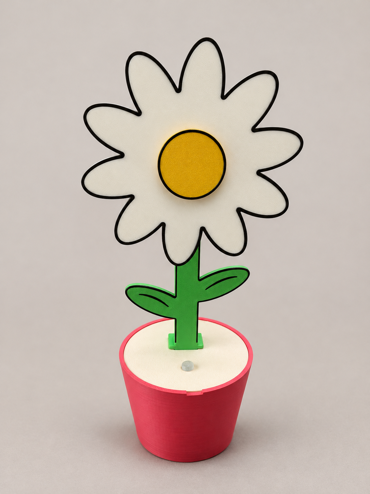

成品展示图经过背景替换；下面的装配照片保留实拍内容。

## 一 材料与工具

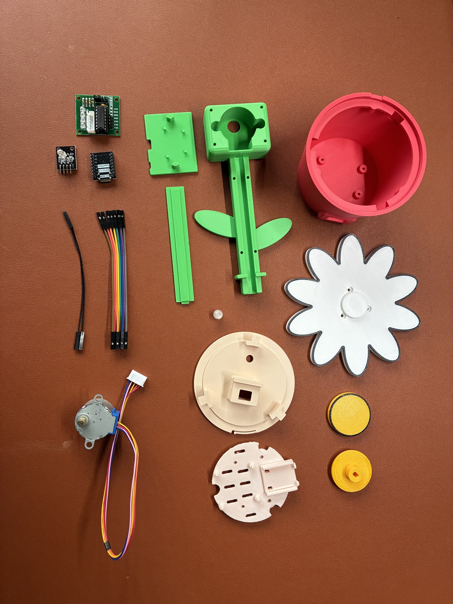

图 1：本次装配的零件全貌。黄色扁圆片是花心，背面带轴孔凸台的黄色圆件是传动连接件，两者用途不同。

### 电子配件

| 配件 | 数量 | 本次使用规格 |
| --- | --- | --- |
| 主控板 | 1 块 | ESP32-C3 SuperMini，带排针及 USB-C 接口 |
| 电机驱动板 | 1 块 | ULN2003，带电机五针插座 |
| 步进电机 | 1 个 | 28BYJ-48，5 V，1:16 减速比；自带五芯线与插头 |
| RGB 灯板 | 1 块 | KY-016 共阴模块，带板载限流电阻，R、G、B、− 四根预焊直角公排针沿板边伸出、平行于 PCB |
| 杜邦线 | 1 组 | 10 cm 母对母；需覆盖 4 路电机控制、1 路 5 V、3 路灯控制及公共地连接 |
| 接地分线 | 1 组 | 一分二连接，使主控 GND 同时连到驱动板 − 和灯板 − |
| USB-C 数据线 | 1 根 | 接电脑，用于供电、烧录和串口通信；不能只支持充电 |

电机自带线不计入杜邦线。准备 **8 根普通母对母线＋1 组一分二共地线**，共地线的三个端口均需匹配板上的公针。留出合盖和再次开盖所需的线长。

### 打印件

本次带灯版本共 **10 个成品零件**，各 1 件：

| 零件 | 作用 |
| --- | --- |
| 枝干及叶片 | 上端容纳电机，背面线槽把电机线引到底部 |
| 电机后盖 | 合上电机腔，照片所选版本标记为 3 |
| 藏线盖 | 覆盖枝干背面的长线槽 |
| 白黑花盘 | 随电机旋转 |
| 黄黑花心 | 安装在花盘正面中心 |
| 传动连接件 | 位于花盘背面，连接电机输出轴 |
| 花盆 | 容纳电路与托盘 |
| 带灯盆盖 | 固定枝干，背面带灯板安装台及出光孔 |
| 透明灯帽 | 位于盆盖正面的小圆孔处 |
| 电子托盘 | 固定两块电路板，底部套环与盆内定位柱配合 |

主体使用 **PLA**，灯帽使用透明 PLA。双色件的黑边与主体一起打印。盆体和连接件可换成喜欢的颜色，保持原尺寸。

打印起点为 0.4 mm 喷嘴、0.20 mm 层高、100% 原尺寸；各零件墙数、填充和摆放方向见[打印与干装说明](PRINTING.md)。先试装，再做下面的固定步骤。使用同一套模型里的盆盖、灯帽和托盘。

### 工具与辅料

准备热熔胶枪及胶棒、修边工具、镊子、绝缘胶带。遮挡驱动板指示灯时，再准备一小片不透光、表面绝缘的材料。

板卡、灯板和电机用少量热熔胶固定，传动连接件卡入花盘。花心、透明灯帽和枝干先不用胶试装，检查松紧。

## 二 接线表

**所有插拔、点胶和调整均在拔掉 USB 后进行。** 5 V 电机使用主控的 5V 供电端，不接 3V3。按电路板丝印找端子，照片里的线色只帮助辨认走向，不代表统一的电气定义。

| 从 ESP32-C3 出发 | 接到 | 用途 |
| --- | --- | --- |
| 5V | ULN2003 电源 + | 电机电源 |
| G / GND | 一分二后接 ULN2003 − 和 KY-016 − | 公共地 |
| GPIO4 | ULN2003 IN1 | 电机控制 1 |
| GPIO5 | ULN2003 IN2 | 电机控制 2 |
| GPIO6 | ULN2003 IN3 | 电机控制 3 |
| GPIO7 | ULN2003 IN4 | 电机控制 4 |
| GPIO0 | KY-016 R | 红色通道 |
| GPIO1 | KY-016 G | 绿色通道 |
| GPIO3 | KY-016 B | 蓝色通道 |

```text
电脑 ── USB 数据线 ── ESP32-C3
                       ├─ 5V ───────── ULN2003 +
                       ├─ GND ──┬───── ULN2003 −
                       │        └───── KY-016 −
                       ├─ GPIO4/5/6/7 ─ ULN2003 IN1/2/3/4
                       └─ GPIO0/1/3 ─── KY-016 R/G/B

ULN2003 五针插座 ── 电机自带五针插头
```

**先穿线，后插电机插头：** 电机插头需要穿过盆盖的方孔，见步骤 5。GPIO 编号是板上的引脚名称，不是从上到下数的第几根针。

## 三 装配步骤

### 步骤 1 将两块电路板固定到托盘

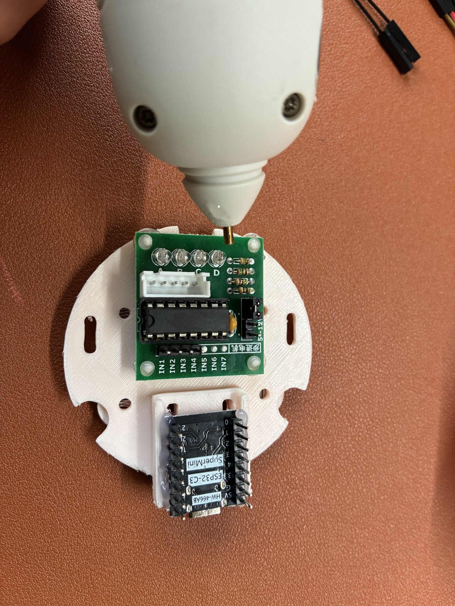

图 2：驱动板在圆托盘的大面上，主控板在侧边的小框内，USB-C 接口朝向托盘外缘。

1. 清除打印支撑和毛边，先将托盘放进花盆试位，让主控 USB 口能对准盆侧开口，再拿出托盘装板。
2. 按图摆放 ULN2003 和 ESP32-C3，确认排针、电机插座和 USB 接口都能正常插拔。
3. 在板边与托盘接触位置少量点热熔胶加固，等胶冷却后再移动。不要让胶堵住接口或包住需要插线的针脚。

**检查：** 两块板不会在托盘上晃动；USB 口朝外；托盘仍可独立取出维护。

### 步骤 2 装入电机并封好线槽

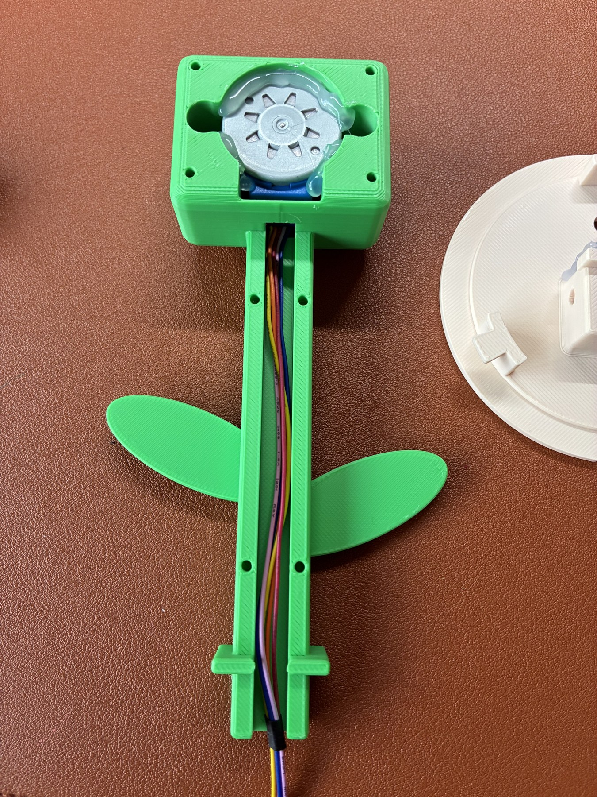

图 3：从枝干背面看，电机出线端朝下，输出轴从另一面伸出。

1. 将电机放进枝干顶部圆腔，使输出轴穿过正面的轴孔。
2. 先确认电机坐正、轴没有擦到打印件，再在外壳与安装腔的接触位置点热熔胶加固；轴与活动部位不点胶。
3. 将五芯线平顺地放进枝干背面长槽，从底部引出，避免线束压在盖边上。
4. 装上电机后盖和藏线盖。不要用盖子的压力强行挤平线束。

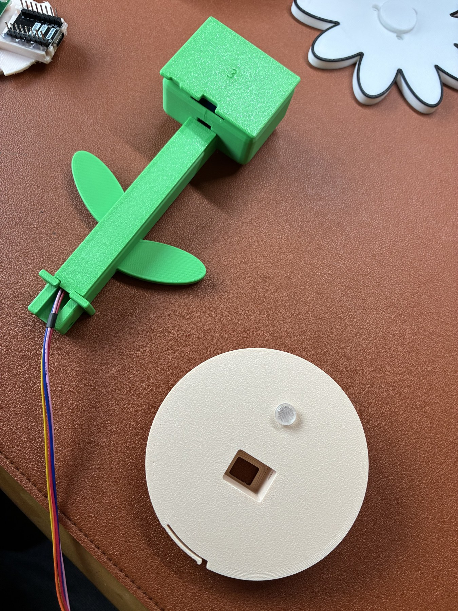

图 4：电机后盖与长条藏线盖装好后的背面，底部保留电机线出口。

**检查：** 盖子贴合，线皮没有被夹住，轴周围没有胶或毛边干涉。

### 步骤 3 把提醒灯装到盆盖背面

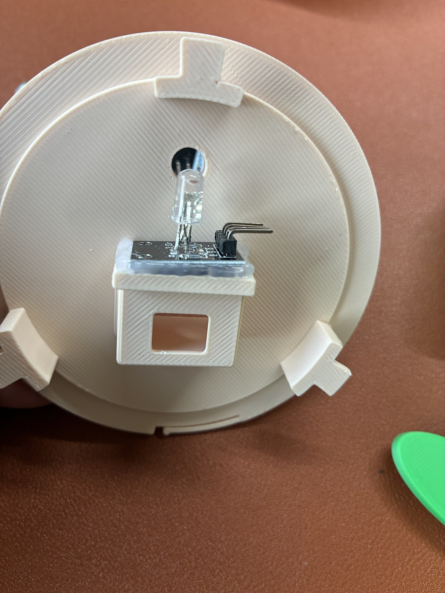

图 5：LED 对准圆形出光孔，灯板固定在盆盖背面的小安装台上，排针留出接线空间。

1. 先试放灯板，让 LED 对准小圆孔，不能遮挡旁边的枝干方孔。
2. 在灯板与安装台的接触位置少量点热熔胶，保持对准直到冷却。
3. 从正面装入透明灯帽，先不用胶，检查它是否顶住 LED、是否容易脱落。

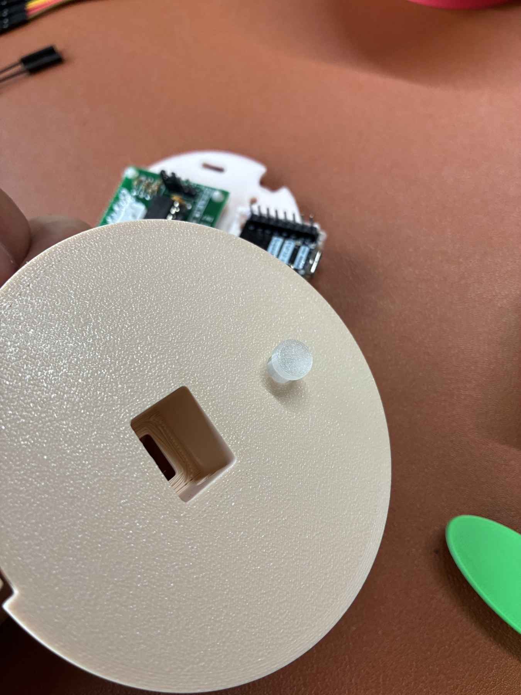

图 6：盆盖正面的透明灯帽。KY-016 使用四根预焊直角公排针，沿板边伸出、平行于 PCB；安装时给母头和线束留出空间。

**检查：** 灯板固定，LED 朝向出光孔，枝干通道保持畅通，四个端子可插线。

### 步骤 4 组合花盘与传动连接件

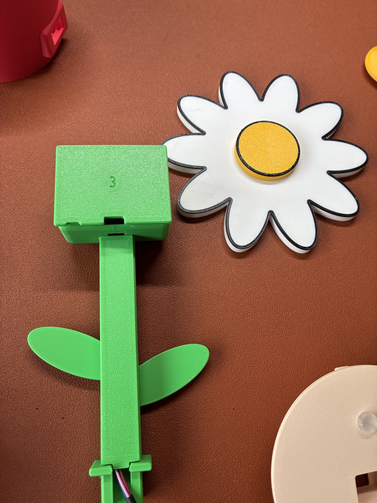

图 7：黄黑花心位于花盘正面中央。

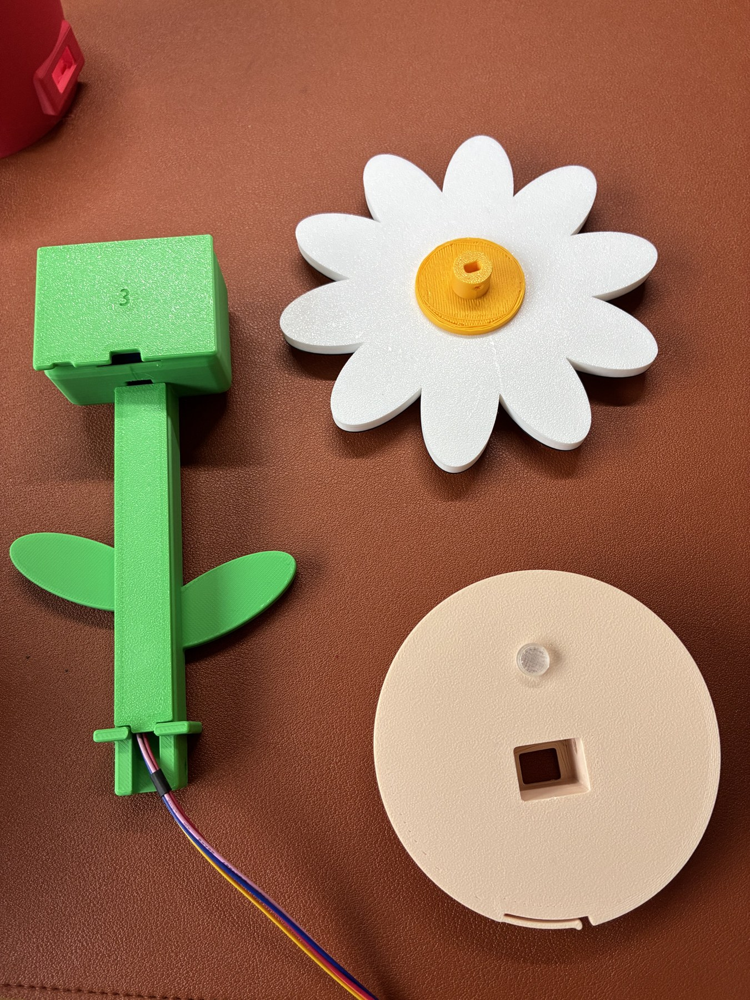

图 8：黄色连接件在花盘背面，带轴孔的凸台朝外，之后与电机轴配合。

1. 对齐花盘中央配合位置，将传动连接件卡入背面。需要时可在接触处少量点胶，保持轴孔干净。
2. 将花心不加胶装到花盘正面，检查是否贴合、是否容易松脱。
3. 暂时把整片花盘放在一旁，等电路与空轴测试完成后再装到电机上。

**检查：** 正面为黄黑花心，背面为轴孔凸台；连接件与花盘同心、不松动。

### 步骤 5 电机线先穿过盆盖 再安装枝干

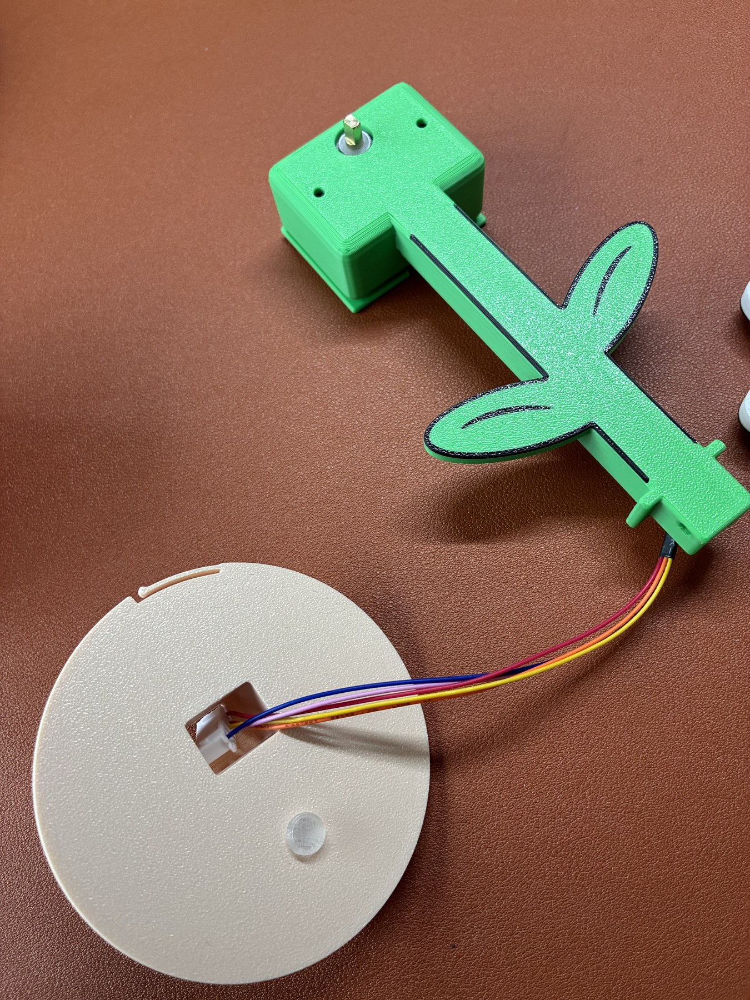

图 9：电机暂时不接驱动板，先让白色五针插头穿过盆盖方孔。

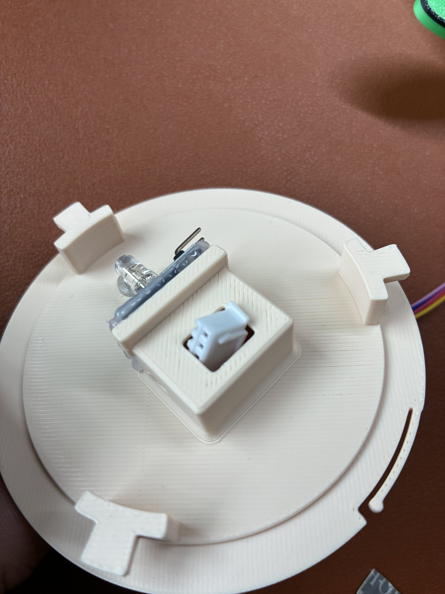

图 10：插头穿到盆盖背面后，才能继续把枝干底端装入方孔。

1. 将电机白色五针插头从盆盖正面穿向背面。若之前试接过驱动板，此时先拔下。
2. 轻拉出余线，再把枝干底端插进方孔。让带黑色装饰线的枝干正面与灯帽朝同一侧。
3. 检查枝干底部是否落位、是否晃动，以及线束是否夹在方孔边缘。

**检查：** 电机插头在盖子下面，枝干就位，灯板和电机线互不挤压。

### 步骤 6 接线并在合盖前测试

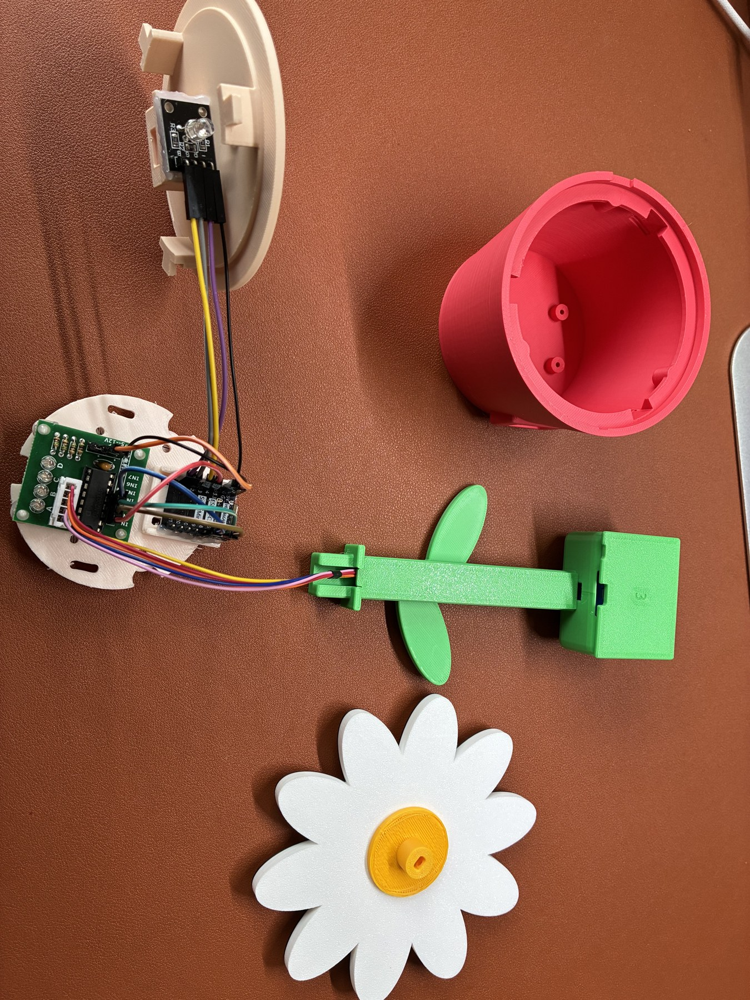

图 11：电路连接全貌。这张是分开放置的接线展示；实际装配先完成步骤 5 的穿线，再接电机。

1. 按第二节接线表逐条连接主控、驱动板和灯板，特别核对 5V、GND 及灯板 R/G/B/−。
2. 用一分二地线让灯板和电机驱动板共地。
3. 将电机五针插头完全插进驱动板插座。收线时留出盆盖打开所需的余量，不靠拉扯排针保持位置。
4. 暂不装花盘，将零件稳妥放好；检查没有短接后，按第四节进行低速和灯光测试。测试完成发送停止、关灯命令，再拔掉 USB。

**检查：** 空轴能够启停；灯能够开关；断电后才能继续遮光与入盆。

### 步骤 7 遮住驱动板指示灯

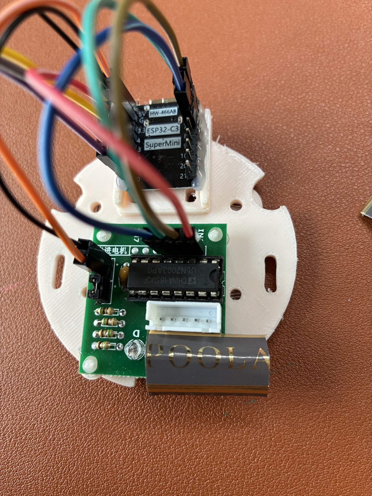

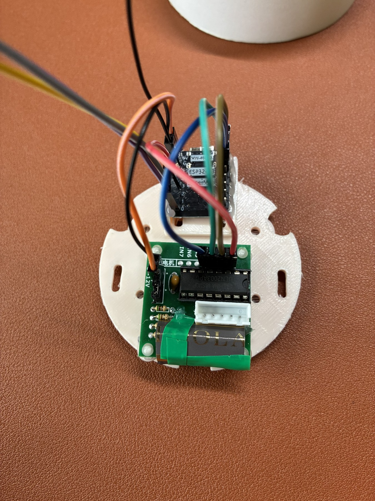

图 12、13：作者用遮光片和绿色胶带盖住驱动板指示灯，避免它们透过花盆影响提醒灯的辨识。

用不透光且接触电路的一面绝缘的材料盖住指示灯，再用绝缘胶带固定。避免金属箔或导电涂层接触焊点。

**检查：** 遮光片固定牢靠，没有挡住电机插座、排针或压迫线束。

### 步骤 8 把托盘放入花盆并合盖

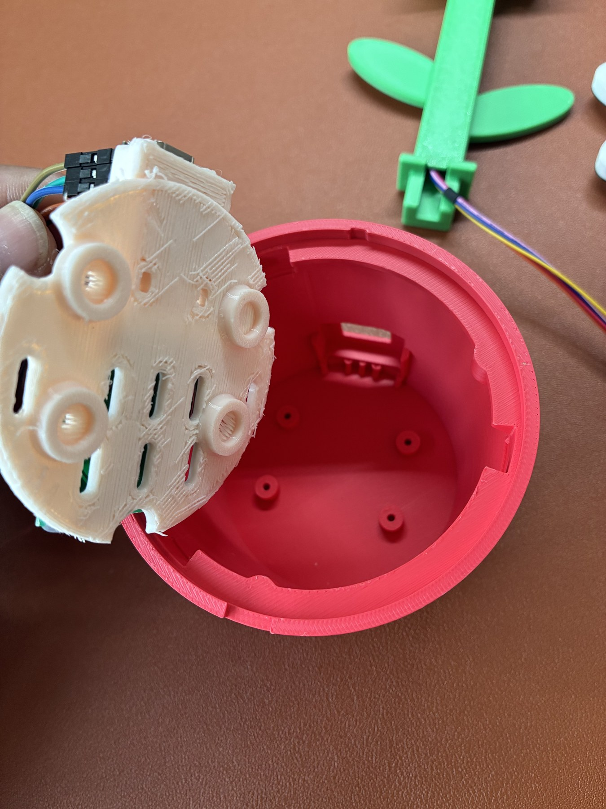

图 14：托盘底部的套环对准盆内定位柱，放下前再次核对 USB 口方向。

1. 将托盘对准定位柱放入盆体，让主控 USB 口对齐侧面开口。本次板卡用热熔胶固定在托盘上，托盘与盆体保持可分离。
2. 将多余线束平缓收进盆内，避开托盘支点、盖子卡扣和灯板，不强行压盖。
3. 将盆盖的旋扣对准盆体缺口，轻放到位，从上方看顺时针约 30° 转到限位。
4. 从侧面确认 USB 数据线能够正常插入，外壳没有把插头顶歪。

**检查：** 盆盖贴合，枝干站稳，接线不受拉力，USB 口可用；再次开盖时托盘和线束可以维护。

### 步骤 9 最后安装花盘

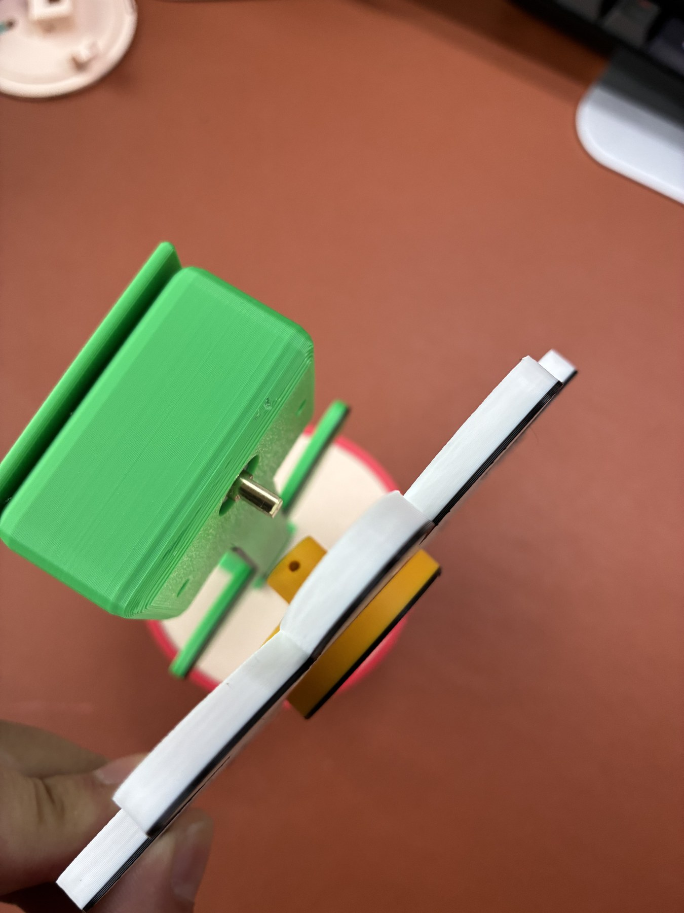

图 15：黄色连接件的轴孔朝电机，先对齐电机轴扁位，再沿轴向安装。

1. 扶稳电机座，对准连接件孔形与电机轴的扁位。
2. 沿轴向平稳装入，不靠扭花瓣去强行扩孔，也不要把花盘压到电机座上。
3. 从侧面检查花盘背面与绿色电机座之间留有活动间隙。
4. 放稳整机后接上 USB，先用低速测试；如果晃动、摩擦或异响，立即停止并断电检查。

**检查：** 花盘与轴配合稳固，旋转过程中不擦到电机座、叶片或其他物品。

## 四 固件与首次测试

使用[旋转＋提醒灯组合固件](../../firmware/flower_integrated/flower_integrated.ino)，设备身份为 `FLOWER_COMBINED_V1`。

1. 用 USB 数据线连接 ESP32-C3，在 Arduino IDE 中打开组合固件。已验证配置为 Arduino-ESP32 **3.3.11**，板型 **ESP32C3 Dev Module**，**USB CDC On Boot = Enabled**、**Flash Mode = DIO**、**Upload Speed = 115200**；选择实际串口后上传。USB CDC 设置关系到能否通过板载 USB 收到下述串口回应。
2. 打开串口监视器，设置 **115200 波特率**，每条命令以换行结束。初次制作应先完成固件测试，再安装 Mac 桥接程序；如果这台 Mac 已装有小花后台，先暂停其服务再开串口监视器，仅关闭 Codex 或 WorkBuddy 窗口不等于释放串口。可用安装包中的「卸载小花.command」移除后台，测试后重新安装；卸载会停止该 Mac 上全部小花联动，日志和备份保留。
3. 依次执行下表。每次移动零件或修改接线前都先断电。

| 发送命令 | 应看到的结果 |
| --- | --- |
| `DEVICE INFO` | 回应含 `FLOWER_COMBINED_V1 PWM=OK` |
| `PING` | 回应 `PONG` |
| `RUN LOW` | 回应 `RUNNING LOW`，电机低速转动 |
| `STOP` | 回应 `STOPPED`，电机停转 |
| `ATTENTION ON` | 提醒灯亮起并呼吸 |
| `LED STATUS` | 灯开启期间回应含 `LED_STATE=ON PWM=OK` |
| `ATTENTION OFF` | 提醒灯熄灭 |

手动发送一次 `ATTENTION ON` 后，灯约 6 秒未收到续期会自动熄灭；电机约 30 秒未收到运行续期会自动停止，这是固件的超时行为。查看灯状态要在灯熄灭前完成。

空轴测试通过后再装花盘，重复低速测试。需要验证其他速度时，按 `LOW → MEDIUM → HIGH → XHIGH → ULTRA` 逐档短测，每档之后发送 `STOP`，观察停转，再继续下一档；发现摩擦或明显丢步就停下检查。

单独验证超时：发送一次 `RUN LOW` 后不再发 `RUN`，约 30 秒后应收到 `TIMEOUT` 并停转；发送一次 `ATTENTION ON` 后不续期，约 6 秒后收到 `ATTENTION_TIMEOUT` 并熄灯。完成时再发 `STOP`、`ATTENTION OFF`，分别用 `STATUS`、`LED STATUS` 确认 `IDLE`、`LED_STATE=OFF`。

测试完成后，按[装配检查表](CHECKLIST.md)核对整机。

## 五 安装 Mac 联动软件

使用 **Apple 芯片 Mac、macOS 12 及以上**，连接本机 Codex、WorkBuddy 或 DSH；DSH 适配需要 **macOS 13 及以上**。先完成小花的烧录和手动测试，再安装联动软件。使用 DSH 时，安装前先打开一次应用，让它生成本机配置。

1. **关闭 Arduino 串口监视器**。同一串口只能由一个桥接程序占用，不要同时启动旧 `global_bridge.py`。
2. 准备 [v0.7.0 统一安装包](https://github.com/dalaofei1154/rotating-flower/releases/tag/v0.7.0)，解压后双击 **安装小花.command**。包内附带 Python，不需要 API Key，不会给控制板烧录固件。
3. 安装器自动识别已装的 Codex、WorkBuddy 和 DSH。安装后打开应用、登录并发起任务；DSH 需要退出重开以加载插件。以后新增另一个应用，再运行一次安装器。
4. 如果 macOS 弹出安全提示，按[安装说明](../open-release/INSTALL.md)中的步骤允许打开安装脚本。
5. 从一个任务开始实测：工作时转、全部任务结束后停；触发一个结构化问题卡，观察呼吸灯，回答后检查提醒解除。完成、取消和等待时若还有其他任务工作，小花可继续转动。
6. 多来源用户再测一次并行：一个任务等待回答、另一个工作，预期可以同时转动和亮灯；全部工作及待答事项清除后应停转并灭灯。

WorkBuddy 快速／均衡／极致分别使用 `LOW`／`HIGH`／`ULTRA`；Codex 按所选推理强度使用五档转速；DSH 的档位映射见[适配说明](../dsh-macos.md)。提醒灯对应应用中的待处理问题或授权。

联动软件在登录 Mac 后自动运行。卸载时，解压安装包并双击 **卸载小花.command**；后台服务及 DSH 插件注册会被移除，备份及日志保留。卸载后重启 DSH。更多设置见[安装说明](../open-release/INSTALL.md)。

## 六 完成检查与排错

- [ ] 盆体站稳，枝干、花盘和连接件没有松脱。
- [ ] 花盘低速旋转无明显偏摆，不擦壳、不夹线。
- [ ] `STOP` 可停转，提醒灯可独立开关。
- [ ] 提醒灯清晰可见，驱动板指示灯没有造成混淆。
- [ ] USB 插拔顺畅；盖子锁紧时不挤压线束。
- [ ] 记录本次固件版本、打印参数和实测现象，便于其他人复现。

| 现象 | 排查顺序 |
| --- | --- |
| 电脑找不到串口 | 换确认支持数据的 USB 线；检查接口是否被胶或外壳挡住；确认所选串口 |
| 串口有回应但电机不转 | 断电后检查 5V/公共地、IN1–IN4 顺序和电机五针插头；先用 LOW 复测 |
| 花盘抖动、摩擦或松脱 | 停转断电；检查连接件、轴孔扁位、同心程度和背面间隙；不要直接调高速 |
| 电机正常但灯不亮 | 核对组合固件身份、GPIO0/1/3、共阴灯板及公共地；重发 ATTENTION ON |
| 手动测试几秒后灯灭 | 先核对 6 秒未续期自动关闭的行为，再判断接线问题 |
| 合盖后才出故障 | 断电开盖，检查接头被拉松、线束被夹住或金属接点碰触 |

## 七 许可

模型和 DIY 图片采用 **CC BY-NC-SA 4.0**：署名、非商业使用，改编后以相同许可分享。见[模型许可](../../hardware/LICENSE.md)与[图片许可](images/LICENSE.md)。

教程文字采用 CC BY 4.0，软件和固件采用 MIT，详见 [LICENSES.md](../../LICENSES.md)。
