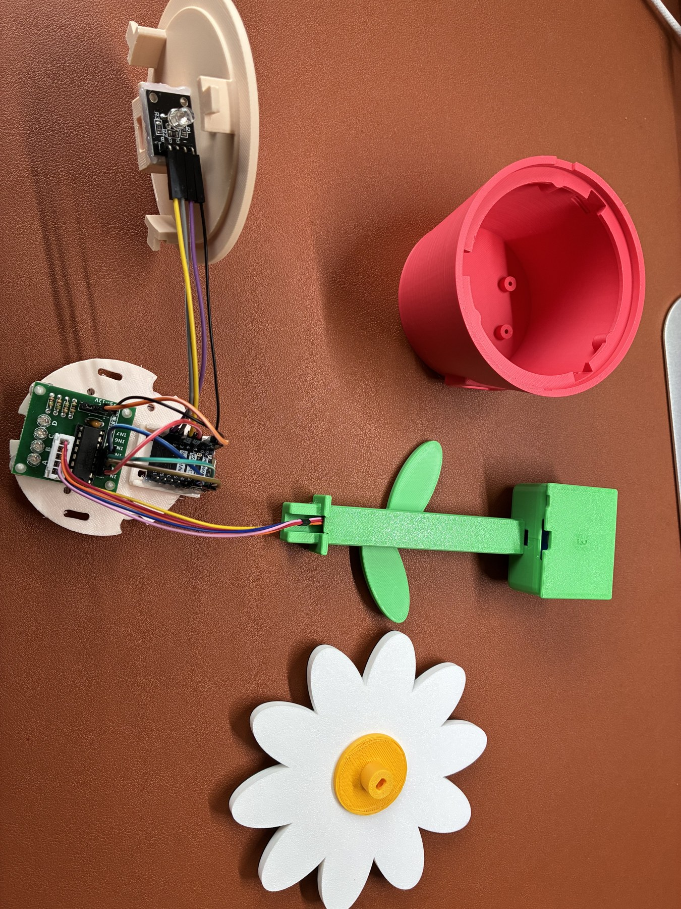

# 接线速查 / Wiring reference

**拔掉 USB 后再插拔、整理或点胶。 / Disconnect USB before wiring, moving connectors or applying glue.**

本表已逐项核对 [组合固件](../../firmware/flower_integrated/flower_integrated.ino) 中的 `kPins`、`ledR`、`ledG`、`ledB`。GPIO 数字是板上名称，不是物理排针的顺序。按实际丝印核对，不靠线色判断。 / The pin names below match the combined firmware. GPIO numbers are labels, not physical header positions. Follow the silkscreen, not wire colors.

| ESP32-C3 SuperMini | 目的端 / Destination | 用途 / Function |
| --- | --- | --- |
| 5V | ULN2003 + | 电机电源 / Motor supply |
| G / GND | ULN2003 − **及 / and** KY-016 − | 一分二共地 / Shared ground via splitter |
| GPIO4 | ULN2003 IN1 | 电机 / Motor |
| GPIO5 | ULN2003 IN2 | 电机 / Motor |
| GPIO6 | ULN2003 IN3 | 电机 / Motor |
| GPIO7 | ULN2003 IN4 | 电机 / Motor |
| GPIO0 | KY-016 R | 红 / Red |
| GPIO1 | KY-016 G | 绿 / Green |
| GPIO3 | KY-016 B | 蓝 / Blue |

```text
Mac ── USB data cable ── ESP32-C3
                         ├─ 5V ────── ULN2003 +
                         ├─ GND ──┬── ULN2003 −
                         │        └── KY-016 −
                         ├─ 4/5/6/7 ─ ULN2003 IN1/2/3/4
                         └─ 0/1/3 ─── KY-016 R/G/B

ULN2003 5-pin socket ── 28BYJ-48 motor plug
```

先将电机五针插头穿过盆盖方孔，再插到驱动板。KY-016 的 `−` 是公共地，不是额外的 5 V 输入；不要把电机接到 3V3，也不要将裸 RGB LED 当作带限流电阻的 KY-016 模块替换。 / Route the motor connector through the lid before plugging it into the driver. KY-016 `−` is ground, not a 5 V input. Do not power the motor from 3V3 or substitute a bare RGB LED for the resistor-equipped module.



照片用于核对布局和走线，逐针连接以表格及板上丝印为准。当前实测方案通过 USB 供电，没有提供外接电源或多电机供电改造教程。 / The photo shows layout; the table and silkscreen determine pin connections. The tested arrangement uses USB power. External supplies and multiple-motor modifications are outside this guide.

返回 [中文教程](README.md) · [English guide](README.en.md)
