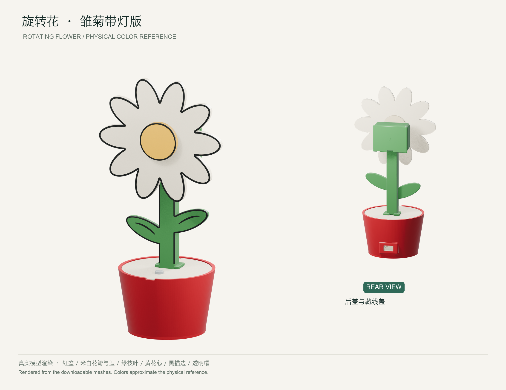
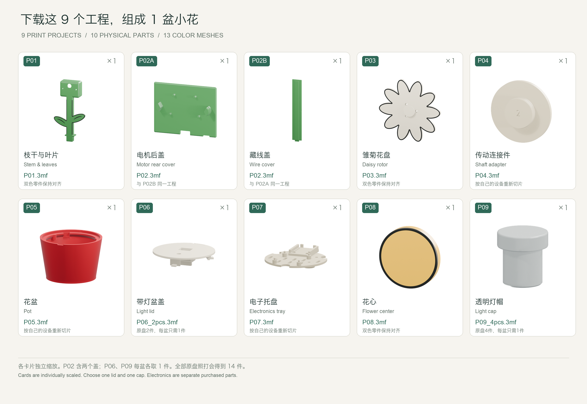
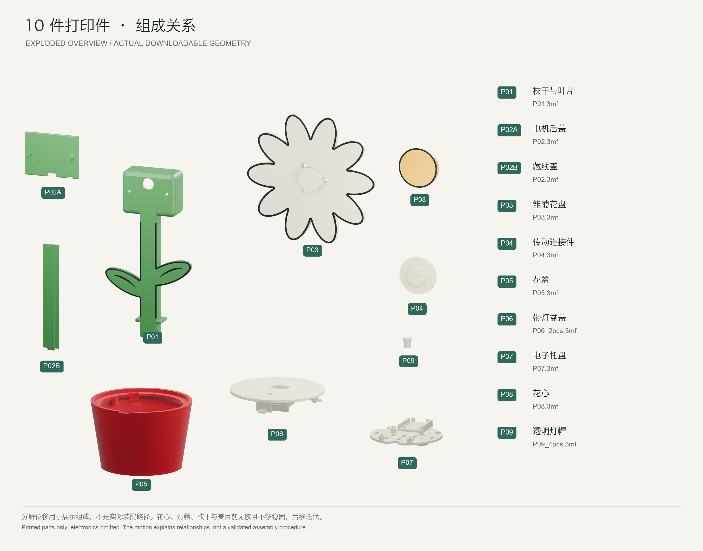

# 雏菊版零件与模型 · Daisy parts and models

[项目介绍](../../README.zh-CN.md#watch) · [Watch the flower](../../README.md#watch) · [制作教程](../../docs/diy-guide/README.md) · [Build guide](../../docs/diy-guide/README.en.md)

## 成品 / The flower

## 3D 功能与组成介绍 / 3D feature and parts explainer

这支 72 秒 3D 介绍片展示小花的功能、10 件组成与装配关系，配有原创音乐。想看实物运行，回到[首页实拍视频](../../README.zh-CN.md#watch)。

This 72-second 3D explainer shows the flower’s behavior, ten parts and how they fit, with original music. Watch the [real flower on the homepage](../../README.md#watch).

### 中文配乐版 / Chinese edition

https://github.com/user-attachments/assets/a38f9855-469f-46ad-a9b5-1f78d493e84b

### English edition

https://github.com/user-attachments/assets/debc0f6c-ad6e-49d3-a212-e0ad689b4f36

[下载中文片 / Download Chinese](visuals/feature-dsh-zh-music.mp4) · [Download English](visuals/feature-dsh-en-music.mp4)

片中的 DSH 联动现已整理到[尚未发版的源码](../../docs/dsh-macos.md)；已发布的 v0.6.0 安装包支持 Codex 和 WorkBuddy。 / DSH support is in the [unreleased source](../../docs/dsh-macos.md#english); the released v0.6.0 installer supports Codex and WorkBuddy.

## 下载零件 / Choose your parts

一朵花需要 **10 个打印件**。按下图编号下载对应工程，打印数量见表格。

One flower needs **10 printed parts**. Match the numbers below to the print files and quantities.

| 编号 / ID | 部件 / Part | 打印工程 / Print file | 每盆数量 / Per flower |
| --- | --- | --- | --- |
| P01 | 枝干与叶片 / Stem & leaves | [P01.3mf](print/P01.3mf) | 1 |
| P02A、P02B | 电机后盖、藏线盖 / Rear cover & wire cover | [P02.3mf](print/P02.3mf) | 各 1 / one each |
| P03 | 雏菊花盘 / Daisy rotor | [P03.3mf](print/P03.3mf) | 1 |
| P04 | 传动连接件 / Shaft adapter | [P04.3mf](print/P04.3mf) | 1 |
| P05 | 花盆 / Pot | [P05.3mf](print/P05.3mf) | 1 |
| P06 | 带灯盆盖 / Light lid | [P06_2pcs.3mf](print/P06_2pcs.3mf) | 原盘 2 件，取 1 / use one of two |
| P07 | 电子托盘 / Electronics tray | [P07.3mf](print/P07.3mf) | 1 |
| P08 | 花心 / Flower center | [P08.3mf](print/P08.3mf) | 1 |
| P09 | 透明灯帽 / Light cap | [P09_4pcs.3mf](print/P09_4pcs.3mf) | 原盘 4 件，取 1 / use one of four |

9 个工程中有备用件，直接整盘打印会得到 14 件。切片时按上表调整数量。图中零件分别放大，方便辨认。

The nine print projects include spares and produce 14 parts if printed as supplied. Adjust the quantities for one flower. Parts are shown at different scales for clarity.

## 零件组成 / How the parts fit

[视频中查看零件组成 / See the parts come together](#animation)

接下来查看[打印设置、分色 STL 与可编辑模型](README.md)，或跟着[图解教程](../../docs/diy-guide/README.md)装配。

Continue with the [print settings, STL files and editable models](README.en.md), then follow the [illustrated build guide](../../docs/diy-guide/README.en.md).
